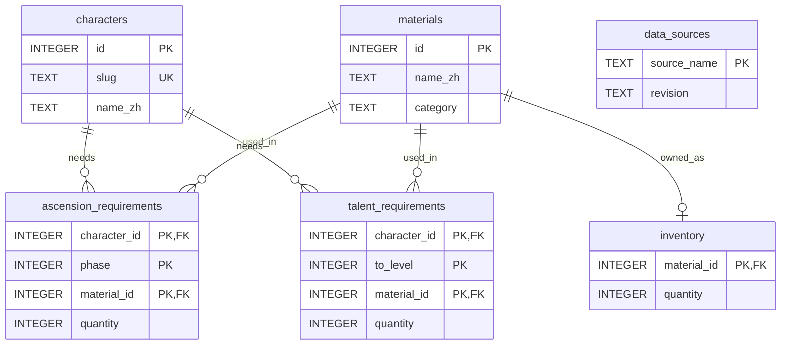

# 数据库设计：E-R Diagram 与 Data Dictionary

本文对应现有 `schema.sql` 和 SQLite 数据库。关系图只保留关键字段，完整字段及约束见数据字典；不表示需要重新建库或增加功能。课程提交格式及是否需要先审批 E-R 图，以教师正式要求为准。

## 1. 简洁实体关系图（E-R Diagram）

图中表名与实际数据库一致。`PK` = Primary Key（主键），`FK` = Foreign Key（外键），`UK` = Unique Key（唯一键）。同一实体中的多个 `PK` 字段共同构成一个复合主键（Composite Primary Key）。

`||` 表示恰好一条，`o{` 表示零到多条，`o|` 表示零或一条。图中的可选性反映数据库约束：外键要求每条需求引用一个存在的父记录，但不要求每个角色或材料必须已经有需求记录。

## 2. 关系与建模范围

| 关系 | 基数（Cardinality） | 含义 |
| --- | --- | --- |
| `characters` → `ascension_requirements` | One-to-Many，1:N | 一个角色可以有多条突破需求，每条需求属于一个角色 |
| `materials` → `ascension_requirements` | One-to-Many，1:N | 一种材料可以出现在多条突破需求中 |
| `characters` → `talent_requirements` | One-to-Many，1:N | 一个角色可以有多条天赋升级需求，每条需求属于一个角色 |
| `materials` → `talent_requirements` | One-to-Many，1:N | 一种材料可以出现在多条天赋升级需求中 |
| `materials` → `inventory` | One-to-Zero-or-One，1:0..1 | 一种材料最多有一条本地库存记录，每条库存必须对应一种材料 |
| `data_sources` | 独立表 | 记录整个快照的来源元数据，不与业务表建立外键关系 |

### 多对多关系（Many-to-Many，M:N）

一个角色需要多种材料，一种材料也可以供多个角色使用。`ascension_requirements` 和 `talent_requirements` 分别作为关联表（Junction Table），将角色与材料的 M:N 关系转换为两侧的 1:N 关系，并保存阶段或等级及需求数量。

- 突破需求的主键是 `(character_id, phase, material_id)`，防止同一角色、同一突破阶段重复登记同一种材料。
- 天赋需求的主键是 `(character_id, to_level, material_id)`，防止同一角色、同一目标等级重复登记同一种材料。
- `quantity` 是单次升级的增量成本，不是累计成本。突破 `phase = 1` 表示 0→1 阶，天赋 `to_level = 2` 表示 1→2 级。

### 统一天赋配方与单本地库存

当前模型假定每位已收录角色的普通攻击、元素战技和元素爆发在相同等级使用同一套材料配方，因此天赋需求表没有 `talent_type` 字段。程序分别读取三个天赋各自的升级区间，再累加成本；三个天赋从 1 升到 10 时，同一套完整配方会计入三次。该假设限定了原型范围，不能据此宣称支持所有特殊成长规则。

`inventory` 代表当前本地演示玩家的共享背包，没有玩家编号。不同角色的计划读取同一个库存；生成计划只计算缺口，不扣减库存，也不预留材料。没有库存记录时，查询通过 `COALESCE` 将已有数量视为 0。

`data_sources` 记录整个数据集的统一来源，不提供逐条角色或材料的来源追踪，也不保存玩家库存的来源。

## 3. 完整数据字典（Data Dictionary）

以下类型为 SQL 中声明的类型。`NOT NULL` 表示不允许 SQL 空值，但不禁止空字符串；`CHECK` 表示检查约束；`DEFAULT` 表示默认值。当前表没有使用 `STRICT`，不能仅凭 `INTEGER` 声明就声称所有直接 SQL 输入都经过严格整数类型验证。

### `characters`：角色信息

| 字段 | 类型 | 键与主要约束 | 含义 |
| --- | --- | --- | --- |
| `id` | INTEGER | PK，整数主键 | 角色标识 |
| `slug` | TEXT | UK，NOT NULL | 唯一英文标识，如 `xiangling` |
| `name_zh` | TEXT | NOT NULL | 中文名称 |
| `name_en` | TEXT | NOT NULL | 英文名称 |
| `element` | TEXT | NOT NULL | 元素 |
| `weapon` | TEXT | NOT NULL | 武器类型 |
| `region` | TEXT | NOT NULL | 地区；现有数据包含空字符串及“未知” |
| `rarity` | INTEGER | NOT NULL；CHECK：1 ≤ rarity ≤ 5 | 稀有度 |
| `normal_attack` | TEXT | 允许 NULL | 普通攻击名称 |
| `elemental_skill` | TEXT | 允许 NULL | 元素战技名称 |
| `elemental_burst` | TEXT | 允许 NULL | 元素爆发名称 |

### `materials`：材料信息

| 字段 | 类型 | 键与主要约束 | 含义 |
| --- | --- | --- | --- |
| `id` | INTEGER | PK，整数主键 | 材料标识 |
| `name_zh` | TEXT | NOT NULL | 中文名称 |
| `name_en` | TEXT | NOT NULL | 英文名称 |
| `category` | TEXT | NOT NULL | 材料类别 |
| `farm_days` | TEXT | NOT NULL；DEFAULT `''` | 开放日展示文本，如“周一、周四、周日”；空字符串表示未记录开放日信息 |
| `farm_hint` | TEXT | NOT NULL；DEFAULT `''` | 一般性获取方向；当前导入程序按类别生成 |

### `ascension_requirements`：突破需求

| 字段 | 类型 | 键与主要约束 | 含义 |
| --- | --- | --- | --- |
| `character_id` | INTEGER | PK 的一部分；FK → `characters.id`；NOT NULL | 角色 |
| `phase` | INTEGER | PK 的一部分；NOT NULL；CHECK：1 ≤ phase ≤ 6 | 本次突破的目标阶段 |
| `material_id` | INTEGER | PK 的一部分；FK → `materials.id`；NOT NULL | 所需材料 |
| `quantity` | INTEGER | NOT NULL；CHECK：quantity > 0 | 该次突破的材料数量 |

复合主键：`(character_id, phase, material_id)`。

### `talent_requirements`：单项天赋升级需求

| 字段 | 类型 | 键与主要约束 | 含义 |
| --- | --- | --- | --- |
| `character_id` | INTEGER | PK 的一部分；FK → `characters.id`；NOT NULL | 角色 |
| `to_level` | INTEGER | PK 的一部分；NOT NULL；CHECK：2 ≤ to_level ≤ 10 | 单次升级的目标等级 |
| `material_id` | INTEGER | PK 的一部分；FK → `materials.id`；NOT NULL | 所需材料 |
| `quantity` | INTEGER | NOT NULL；CHECK：quantity > 0 | 单项天赋该次升级的材料数量 |

复合主键：`(character_id, to_level, material_id)`。三个天赋共用配方的假设见第 2 节。

### `inventory`：单本地库存

| 字段 | 类型 | 键与主要约束 | 含义 |
| --- | --- | --- | --- |
| `material_id` | INTEGER | PK，整数主键；FK → `materials.id` | 材料；每种材料最多一条库存 |
| `quantity` | INTEGER | NOT NULL；DEFAULT 0；CHECK：quantity ≥ 0 | 本地保存的已有数量 |

### `data_sources`：来源元数据

| 字段 | 类型 | 键与主要约束 | 含义 |
| --- | --- | --- | --- |
| `source_name` | TEXT | PK；未显式声明 NOT NULL | 来源名称，当前为 `genshin-db` |
| `source_url` | TEXT | NOT NULL | 来源仓库地址 |
| `revision` | TEXT | NOT NULL | 固定 Git commit 标识 |
| `notes` | TEXT | NOT NULL | 当前保存许可证说明 |

`source_name` 按实际声明记录，不能将其描述为显式具有 `NOT NULL` 约束。快照日期保存在 `data/source_snapshot.json`，本表没有日期或游戏版本字段。

### 外键与索引

全部五条外键均未指定级联操作，`ON UPDATE` 和 `ON DELETE` 使用默认的 `NO ACTION`。应用连接通过 `PRAGMA foreign_keys=ON` 开启外键检查；其他工具建立连接时也需要开启检查。

除主键和唯一约束对应的索引外，`schema.sql` 声明了三个普通索引：

| 索引 | 表与字段 |
| --- | --- |
| `idx_ascension_material` | `ascension_requirements(material_id)` |
| `idx_talent_material` | `talent_requirements(material_id)` |
| `idx_material_category` | `materials(category)` |

## 4. 规范化与提交说明

角色属性、材料属性、需求关系和可变库存分开保存，减少名称重复和更新异常。需求表未重复保存角色或材料名称，数量按完整复合键记录。现有设计仍保留 `farm_days` 多值展示文本和按类别重复的 `farm_hint`，不能宣称数据库严格满足所有范式。第一、第二、第三范式的具体取舍见 [README 的 Normalization 说明](README.md#normalization规范化)。

本项目是已有可运行的课程原型。是否接受 SQLite、E-R 图是否需要预先审批、是否要求严格第三范式及独立的增删改 SQL 演示，需要以教师正式任务书或反馈为准；当前项目目录未附正式评分标准。
